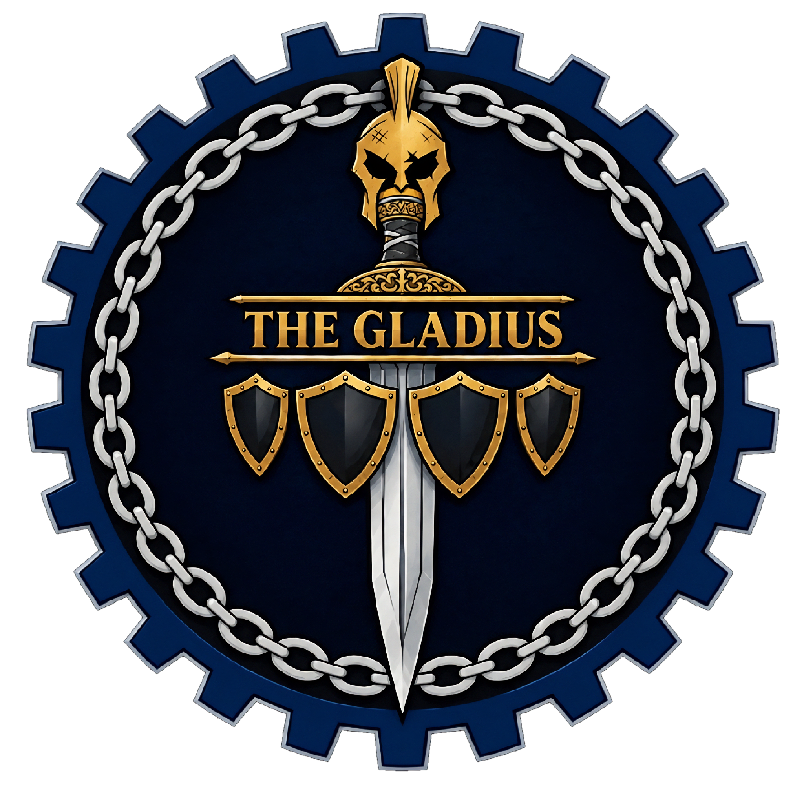

<div align="center">



# The Gladius 26

**Digital Identity Archive**<br>
Fakultas Teknik · Universitas Katolik De La Salle Manado

<sub><i>Rise As One!</i></sub>

<br>

[](https://nextjs.org/)
[](https://react.dev/)
[](https://www.typescriptlang.org/)
[](https://tailwindcss.com/)
[](https://motion.dev/)
[](LICENSE)

[Instagram](https://www.instagram.com/thegladius_26/) · [The Gladiators 23](https://www.instagram.com/thegladiators_23/) · [Universitas Katolik De La Salle Manado](https://unikadelasalle.ac.id/)

</div>

<br>

## About

The digital identity archive of **The Gladius 26**, the 2026 Faculty of Engineering collective at Universitas Katolik De La Salle Manado, born from The Gladiators 23.

A single page, written in Bahasa Indonesia, records who The Gladius are, which generation they were born from, where the name comes from, and what each part of the official emblem means. It is told in four chapters:

| | Section | Subject |
|:---:|---|---|
| **I** | Identitas | Who The Gladius 26 are |
| **II** | Asal-usul | Their lineage from The Gladiators 23 |
| **III** | Makna | Why the name Gladius was chosen |
| **IV** | Lambang | The five elements of the emblem: Pedang, Helm, Rantai, Perisai and Roda Gear |

## Design

The art direction is **Cinematic Heritage × Modern Editorial**: a visible royal-blue foundation, alternating silver chapters, restrained metallic gold and oversized editorial type. The official emblem is the centrepiece. The university and faculty marks appear as supporting affiliations, in their original colours.

| Colour | Role |
|---|---|
|  | Royal blue, main surface |
|  | Deep navy, lineage chapter and footer |
|  | Silver, alternate chapters |
|  | Gold, accents only |

The emblem's gear carries 26 teeth, and the site takes its measurements from them: the reading-progress dial in the header lights the 26 teeth one by one. Motion is kept to one hero sequence and a few chapter transitions, and it stands down when the visitor prefers reduced motion.

Design decisions, palette reasoning and rejected ideas are recorded in [`design/BLUEPRINT.md`](design/BLUEPRINT.md). Colour tokens and brand rules are in [`design/DESIGN-SYSTEM.md`](design/DESIGN-SYSTEM.md).

## Structure 

<details>
<summary><b>Project structure</b></summary>

<br>

```text
src/
├── app/                       Page shell, tokens (globals.css), metadata images
├── content/                   All copy, typed, kept apart from the components
│   ├── site.ts                Names, navigation, logos, official links, credits
│   ├── identity.ts            Bab I
│   ├── origins.ts             Bab II
│   ├── meaning.ts             Bab III
│   ├── emblem.ts              Bab IV and the five element meanings
│   └── closing.ts             Closing and signature
├── components/
│   ├── navigation/            Header, mobile menu, 26-tooth progress dial
│   ├── hero/                  Hero and its keyframe sequence
│   ├── chapters/              The chapters, lineage strands, drawn blade
│   ├── emblem/                Emblem explorer, calibration, 26-tick ring and rack
│   ├── institutional-lockup/  University and faculty marks
│   ├── links/                 External links, and names made clickable in copy
│   ├── motion/                Headlines, gold rule, dimension line, grid, curtain, reveal
│   └── footer/                Institutions, profiles, copyright, credit
└── lib/metadata.ts            SEO and social metadata

public/images/brand/           Byte-identical copies of the three official marks
assets/brand/                  Original brand files and their manifest
design/                        Design system, tokens and blueprint
test/integrity.test.ts         Guards the logos, links and credit
```

</details>

## License

The source code is released under the [MIT License](LICENSE), © 2026 The Gladius 26.

The license does not cover the brand marks. The Gladius emblem, the Universitas Katolik De La Salle Manado logo and the Fakultas Teknik artwork belong to their respective owners and are not licensed for reuse.

<br>

<div align="center">

---

<sub>Website by <b>Mikael Kalesaran</b> for The Gladius 26<br>Fakultas Teknik · Universitas Katolik De La Salle Manado</sub>

</div>
